# Auxx-In

**Search any song, and it plays next.**

Search YouTube Music, YouTube or your own library, or paste a YouTube, YouTube Music or Spotify
link. Auxx-In finds the real song, downloads it, tags it, files it into your music library and
plays it next on your own radio station, which shows up in every
[Navidrome](https://www.navidrome.org/) app you already use.

[](https://github.com/Ikarthikmb/auxx-in/actions/workflows/ci.yml)
[](https://github.com/Ikarthikmb/auxx-in/releases)
[](LICENSE)
[](https://github.com/Ikarthikmb/auxx-in/pkgs/container/auxx-in)

<p align="center">
  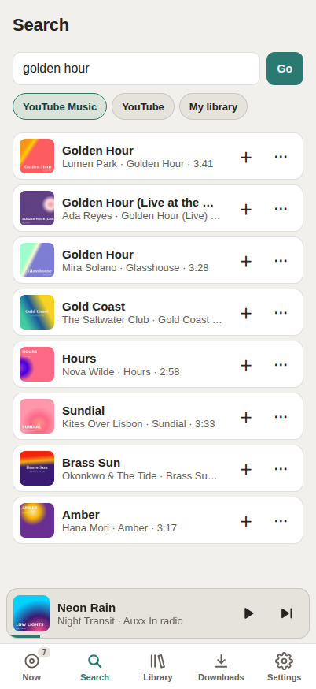
  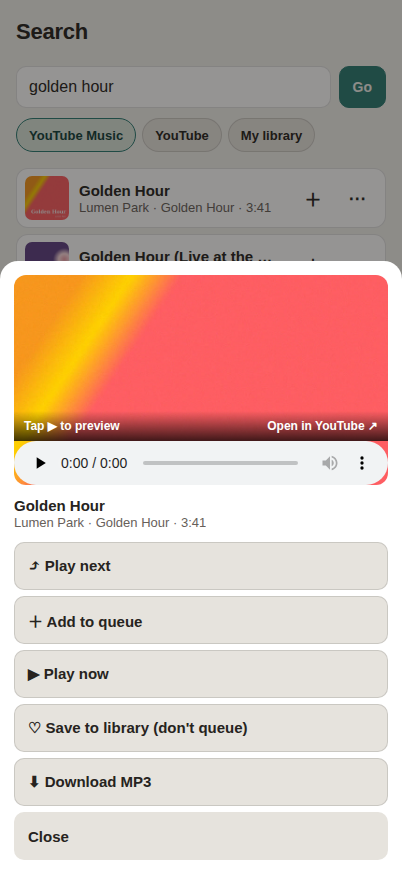
  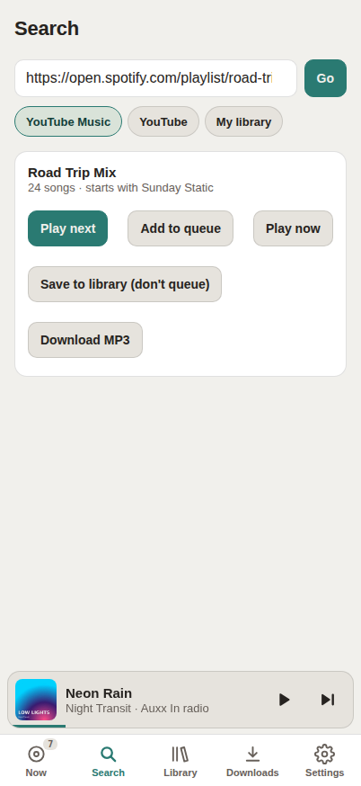
  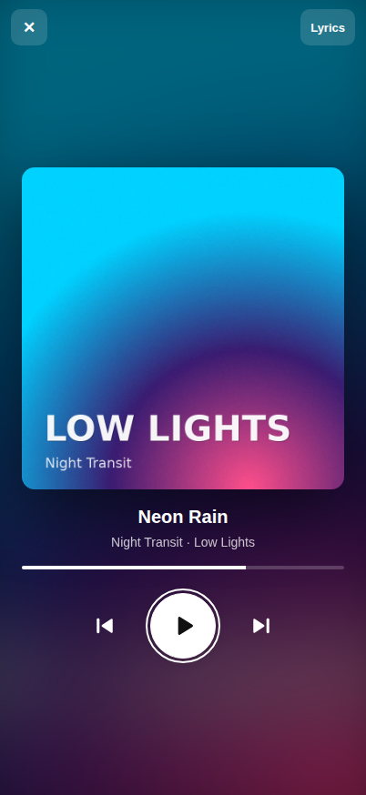
</p>

## Why

You're in the car and want *that* song. Normally that means: find it, download it, tag it, wait
for Navidrome to scan, then play it. The \*arr route (Lidarr, an indexer, a download client) is
built for whole albums, not "play this next".

With Auxx-In you search, tap **Play next**, and it's playing in about a minute: properly tagged,
saved to your library, and on a station everyone in the house or car can add to.

## Features

- **Search or paste a link.** YouTube Music, YouTube or your library. Links from YouTube,
  YouTube Music or Spotify: a song, an album or a whole playlist.
- **Preview first**, then *Play now*, *Play next*, *Add to queue*, *Save to library* or *Download MP3*.
- **The real song.** It picks the original over lyric videos, covers, remixes and karaoke, and
  tags title, artist, album, year and cover art. Files land as `Artist/Album/Title.mp3`.
- **Your own radio.** A Liquidsoap stream that Navidrome lists as a radio station, so any
  Subsonic app plays it: phone, desktop, CarPlay, Android Auto. Or play right in the page.
- **One shared queue.** Everyone with a login can add songs; drag to reorder, swipe to remove.
- **Lyrics.** Synced lyrics, and a full-screen lyrics / cover view made for a TV or a phone on a stand.
- **Your library.** Browse Navidrome albums, artists, playlists and favorites; queue any of them.
- **Aux IQ** (optional). Keeps the music going with songs like what's playing, or for a mood
  ("rainy drive"), using any OpenAI-compatible model.
- **Made for Navidrome, works without it**: then it's a stream plus a web player.
- **Easy to run.** One `docker compose up`, settings on the page, logins, dark mode, installs
  to your home screen.

## Quick start

You need Docker with Compose.

```sh
git clone https://github.com/Ikarthikmb/auxx-in.git && cd auxx-in
printf 'PUID=%s\nPGID=%s\n' "$(id -u)" "$(id -g)" > .env   # run as you, so files are yours
docker compose up -d
```

Then:

1. Get the one-time setup code: `docker logs auxx-in-web 2>&1 | grep -A1 "first run"`
2. Open **http://localhost:8140** and create your admin account with it.
3. Search a song and tap **Play next**. Songs are saved in the `music/` folder.

Listen in the page (**Now → This device**), or turn the radio on (**Settings → Radio**) and
open `http://localhost:8141/aux.mp3` in any player.

> Reaching it from other devices: add `AUX_BIND=0.0.0.0` (or your LAN / VPN address) to `.env`
> and run `docker compose up -d` again. Keep it off the open internet unless it's behind HTTPS.

## Connect Navidrome

1. Point Auxx-In at the folder Navidrome scans: add `MUSIC_DIR=/path/to/navidrome/music` to
   `.env` (it must be writable by your user), then `docker compose up -d`.
2. In **Settings → Configuration → Navidrome**, enter Navidrome's address (as the container
   reaches it, e.g. `http://192.0.2.10:4533`) and a Navidrome username and password.
3. In **Settings → Configuration → Radio**, set the stream address as your phone reaches it:
   `http://<this-server>:8141/aux.mp3`.
4. In your Navidrome app: **Radio → Auxx-In**.

Now Navidrome users can log in with their own accounts (Navidrome admins are admins), and the
Library tab shows your collection.

## Screenshots

<details>
<summary><b>Phone</b>: now playing, library, queue, downloads, dark theme, settings</summary>
<p align="center">
  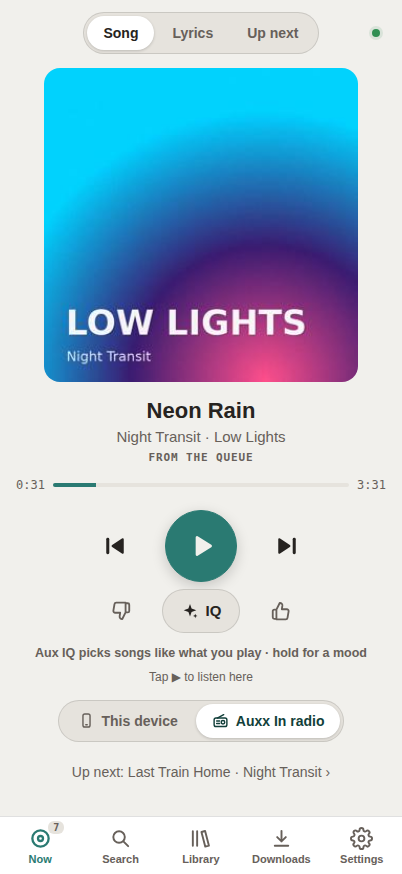
  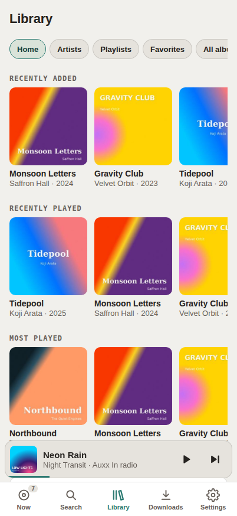
  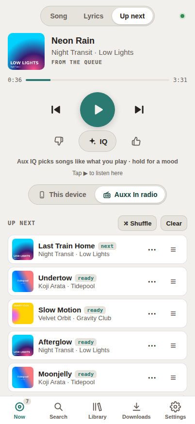
  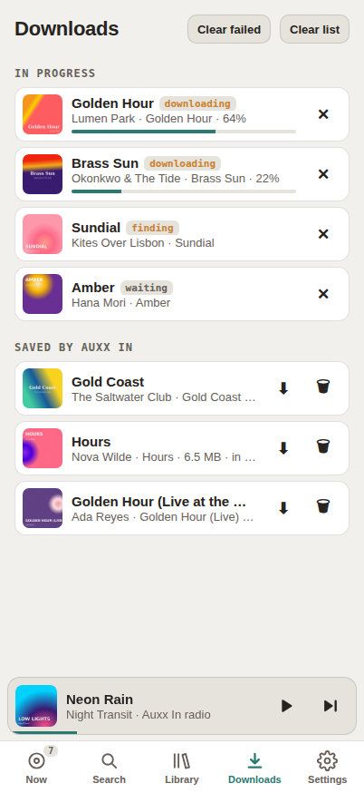
</p>
<p align="center">
  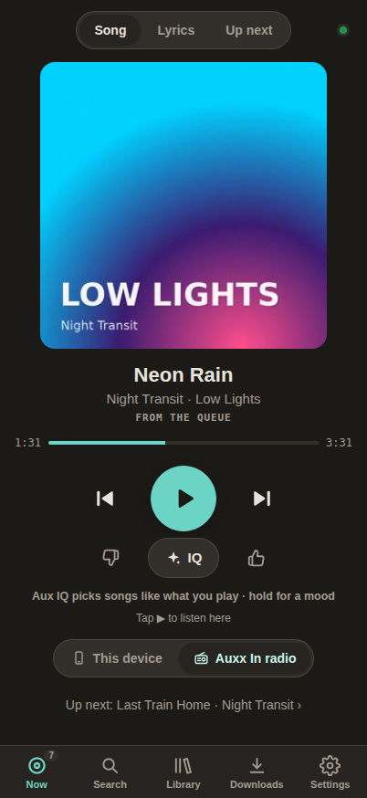
  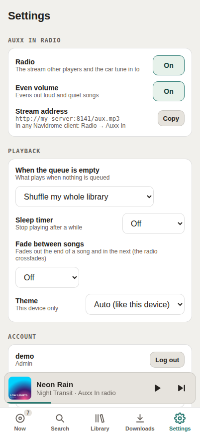
  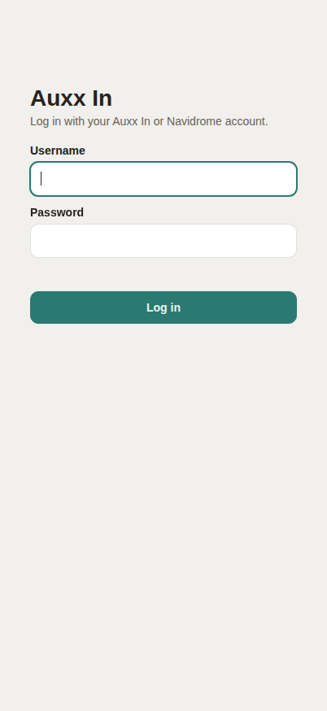
</p>
</details>

<details>
<summary><b>TV and desktop</b></summary>
<p align="center">
  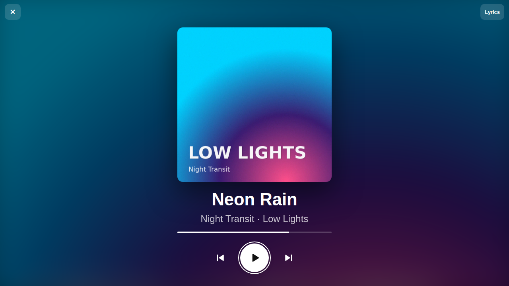
</p>
<p align="center">
  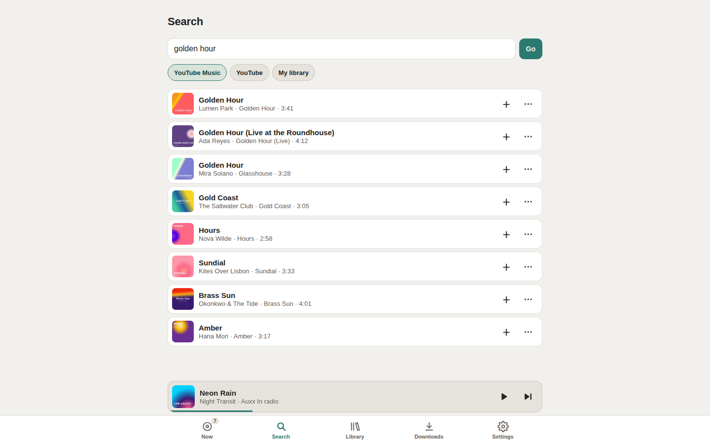
  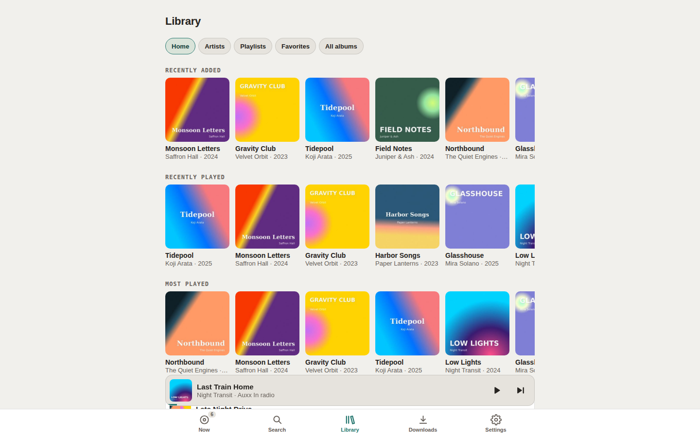
  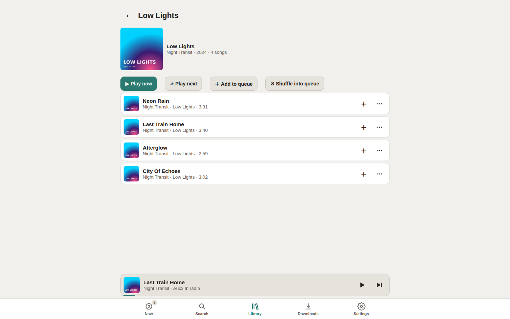
  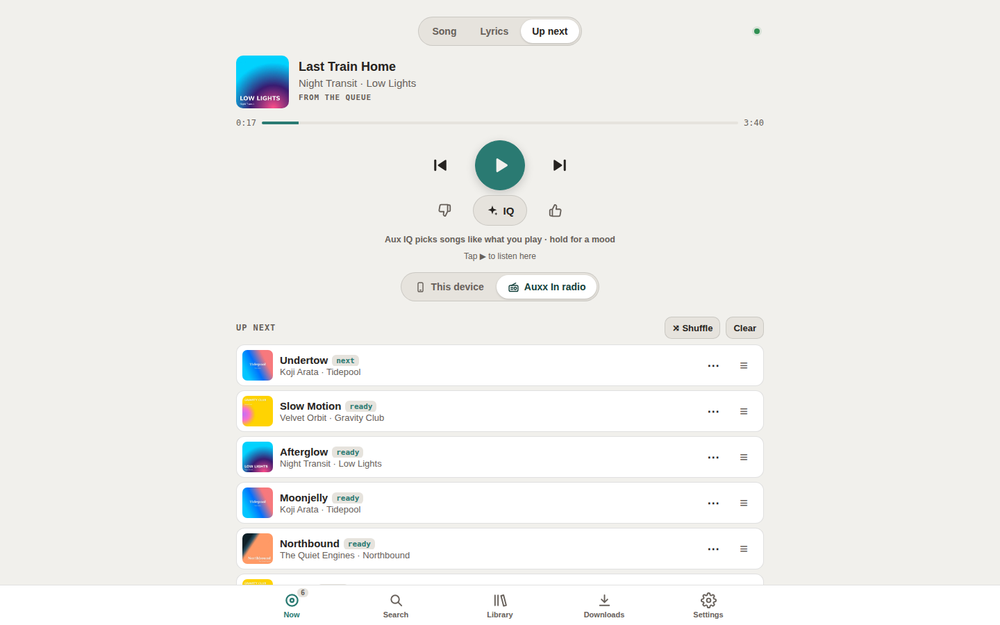
</p>
</details>

<sub>Screenshots use made-up demo data: invented artists and search results, generated covers.</sub>

## FAQ

**Does it replace Lidarr?** No, they do different jobs. Lidarr is great for whole albums in
lossless through indexers. Auxx-In is for single songs, right now. To run both, give Auxx-In its
own subfolder (`MUSIC_DIR=/music/auxx-in`) so Lidarr leaves those files alone; Navidrome picks up both.

**What's the audio quality?** YouTube's: about 130–160 kbps, saved as MP3 (Settings →
Configuration → Downloads → MP3 quality). Great for the car or kitchen, not a lossless source.

**Downloads fail with "Sign in to confirm you're not a bot".** YouTube sometimes blocks servers.
Export `cookies.txt` from a browser signed in to YouTube and upload it in **Settings →
Configuration → Downloads → YouTube cookies**. If it keeps failing, update (below): YouTube
changes often and yt-dlp keeps up.

**Can several people use it?** Yes. Add users in **Settings → Users**, or let them log in with
their Navidrome accounts. Admins change settings; listeners search, queue and play.

**Where are my files?** Songs: `music/` (or your `MUSIC_DIR`). Settings, queue, users and keys:
`data/`. Back up `data/` to keep your setup.

**I forgot the admin password.** `docker exec -it auxx-in-web python auth.py create-admin`

## Updating

```sh
cd auxx-in
git pull
docker compose pull
docker compose up -d
```

To stay on one version, set `AUX_VERSION=0.1.0` in `.env`.

## Configuration

Most settings live on the page: **Settings → Configuration**, one card per section, used right
away. Passwords and keys are never shown again; leave a field blank to keep it.

| Section | Settings |
|---|---|
| **Navidrome** | On/off, server address, username, password |
| **Radio** | Stream address that Navidrome apps tune in to |
| **Library** | Requests playlist, songs per shared playlist, similar songs a day |
| **Downloads** | MP3 quality, largest song (100 MB), keep free disk space (5 GB), YouTube cookies |
| **Aux IQ** | LLM endpoint (OpenAI-compatible), API key, model, backup model, picks waiting, downloads a day |

The container settings go in `.env` (see [`.env.example`](.env.example)), then `docker compose up -d`:

| Variable | Default | What |
|---|---|---|
| `PUID` / `PGID` | `1000` | User and group the containers run as; must own `music/` and `data/` |
| `MUSIC_DIR` | `./music` | Where songs are saved and played from |
| `AUX_DATA` | `./data` | Settings, queue, users, keys |
| `AUX_BIND` | `127.0.0.1` | Address the ports listen on |
| `AUX_WEB_PORT` / `AUX_RADIO_PORT` | `8140` / `8141` | The page, and the radio stream |
| `AUX_VERSION` | `latest` | Image tag to run |
| `TZ` | `UTC` | Time zone |

Optional: `COOKIE_SECURE=true` behind HTTPS; `ADMIN_USER` + `ADMIN_PASSWORD` to make the first
admin without the setup code; `AUTH_PROXY_HEADER` for a login proxy; `LIMIT_ADD` / `LIMIT_SEARCH`
rate limits. All are described in `.env.example`.

## Logins and users

Everything except the radio stream needs a login.

| Way in | How | Admin? |
|---|---|---|
| **Auxx-In accounts** | Settings → Users: add, remove, reset passwords | Chosen per user |
| **Navidrome accounts** | With Navidrome on, log in with your Navidrome username and password | Navidrome admins |
| **Login proxy** | Behind Authelia, Authentik or Tinyauth: `AUTH_PROXY_HEADER=Remote-User` (+ `AUTH_PROXY_ADMINS=alice,bob`). Only if Auxx-In can't be reached any other way | Listed users |

The first admin on a new install needs the one-time setup code from `docker logs auxx-in-web`, so
only someone with access to the server can claim it. Passwords are stored as hashes, sessions
last 30 days, every change carries a CSRF token, and logins, shares and searches are rate
limited. See [SECURITY.md](SECURITY.md).

<details>
<summary><b>How it works</b> (for the curious)</summary>

| Container | Port | Role |
|---|---|---|
| `aux-web` | 8140 | Flask app (`web/`) served by waitress: the page, queue, search, downloads and tagging. Image: Python 3.13, yt-dlp (+ Deno, which it needs for YouTube), ffmpeg, ytmusicapi, mutagen. |
| `aux-radio` | 8141 | Liquidsoap 2.4.6 (`radio/aux.liq`). Asks `aux-web` for the next song, falls back to a shuffle of your library when the queue is empty, then crossfade → even volume → MP3 192k at `/aux.mp3`. |

**Finding the song.** Everything resolves to a YouTube Music *song*, so it has a proper title,
artists, album, year and cover, and the audio comes from that same entry.
- YouTube / YouTube Music link: the video itself if it's a catalogue song, otherwise its title is
  searched; if nothing matches, the video's audio is kept under *Singles*.
- Spotify link: song names are read from Spotify's public embed page (no account), then searched
  on YouTube Music. Spotify audio is never used.
- A name: searched. Matching prefers the original over remixes, covers, karaoke, lofi,
  other-language versions and festival promos, and gives up rather than guess.
- Film songs go in the film's album (`Kesariya (From "Brahmastra")` → album *Brahmastra*).
  A song already in your library is reused, not downloaded again.

**Play on.** The switch on Now chooses where the queue plays: **This device** (the page plays
it, with seek and lock-screen controls) or **Auxx-In radio** (the stream, for any number of
listeners). Switching hands the song over at about the same spot.

**When the queue is empty**, it plays your choice: library shuffle, the Requests playlist, a
playlist, an artist, similar songs (from YouTube Music's radio), Aux IQ, or silence.

**Aux IQ** keeps a few picks waiting at the end of the queue, each with a short reason. It
learns from 👍 / 👎 and skips, mixes YouTube Music's radio for recent songs with library songs
by artists you like, and with an LLM set up re-orders the picks and handles moods. Only song
titles, artists, the time and the mood are sent to the model. Without one, it runs on scores.

**Daily playlist** (with Navidrome). Each morning one Navidrome playlist is rebuilt for the day
from favourites, songs you haven't heard lately and a few new ones.

**Lyrics** come from [LRCLIB](https://lrclib.net), looked up in the background while someone
has lyrics open.

**The code.** `web/app.py` (queue, radio control, routes), `web/songs.py` (matching, download,
tagging), `web/nav.py` (Navidrome), `web/config.py` (settings), `web/auth.py` (logins),
`web/static/` (the page), `radio/aux.liq` (the radio).
</details>

## Development

```sh
docker compose -f docker-compose.yml -f docker-compose.build.yml up -d --build   # run from source
pip install -r requirements-dev.txt                                               # Python 3.13
ruff check . && pytest -q                                                         # lint + tests
./scripts/check-public.sh                                                         # nothing private
```

The page is plain JavaScript with no build step. CI runs the privacy check, lint, tests and an
image build on every push; a `v*` tag publishes the image for amd64 and arm64. See
[CONTRIBUTING.md](CONTRIBUTING.md); ideas and pull requests are welcome.

## Personal use

Auxx-In downloads audio with [yt-dlp](https://github.com/yt-dlp/yt-dlp). Only download music you
have the right to, and check the terms of the sites you use (YouTube's terms don't allow
downloading). You're responsible for how you use it. The project ships no music and isn't
affiliated with YouTube, Spotify or Navidrome.

## License

[GPL-3.0](LICENSE)
