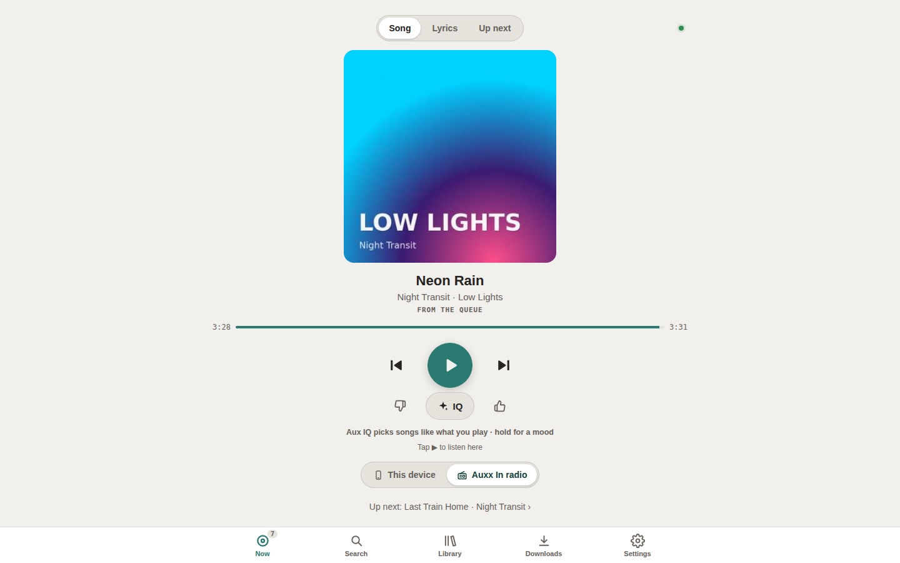

# Auxx In

**Search any song, and it plays next.** Search YouTube Music, YouTube or your own library, or
paste a YouTube, YouTube Music or Spotify link (a song, an album, a whole playlist). Preview it,
then *Play next*, *Add to queue* or just *Save to library*: Auxx In finds the proper release,
downloads it, tags it (title, artist, album, cover) and files it into your music library, then
plays it on the **Auxx In radio**, a self-hosted radio station for your
[Navidrome](https://www.navidrome.org/) library.

<p align="center">
  
  
  
  
</p>
<p align="center"><sub>Search → preview → play next. Paste a link → the whole playlist. Downloads show their progress.</sub></p>

**The radio plays in any Navidrome client.** Auxx In adds an internet radio station called
"Auxx In" to Navidrome, so whichever Navidrome / Subsonic app you already use (phone, desktop,
CarPlay / Android Auto) can tune in, or play it on the page itself. Several people can share
songs and listen at once.

<p align="center">
  
  
  
  
</p>
<p align="center">
  
</p>
<p align="center">
  
  
  
</p>
<p align="center"><b>On a desktop</b></p>
<p align="center">
  
  
  
  
  
</p>

<p align="center"><sub>Screenshots use made-up demo data: invented artists and search results, generated covers.</sub></p>

> **For personal use.** Auxx In downloads audio with [yt-dlp](https://github.com/yt-dlp/yt-dlp).
> Only download music you have the right to, and check the terms of the sites you use
> (YouTube's terms don't allow downloading). You are responsible for how you use it. The
> project ships no music and has no affiliation with YouTube, Spotify or Navidrome.

## Quick start

```sh
git clone https://github.com/ikarthikmb/auxx-in.git && cd auxx-in
cp .env.example .env && chmod 600 .env   # set PUID/PGID (and MUSIC_DIR, AUX_BIND)
docker compose up -d --build             # then open http://<host>:8140
```

The first visit asks you to create the admin account, with the one-time **setup code** from
`docker logs auxx-in-web` (or, with Navidrome set up, log in with your Navidrome account).
Details: [Login and users](#login-and-users).

## Made for Navidrome, works without it

Switch it in **Settings → Configuration → Navidrome → Use Navidrome**. With it off, or with
no server address set, Auxx In runs on its own:

| | With Navidrome | Without |
|---|---|---|
| Share, search YouTube / YouTube Music, download + tag into the music folder | ✅ | ✅ |
| Queue, play next, reorder, history, lyrics | ✅ | ✅ |
| Play on this device (the Auxx In page) | ✅ | ✅ |
| Radio stream `http://<host>:8141/aux.mp3` | ✅ in any Navidrome client (Radio → Auxx In) | ✅ in any player that takes a stream URL (VLC, a browser…) |
| When the queue is empty: library shuffle, similar songs, Aux IQ | ✅ | ✅ (from the music folder) |
| Library tab, favorites, playlists, Requests playlist | ✅ | hidden |

- **Play on** (switch on the Now tab). Switching hands the song over: the other player carries
  on with the same song from about the same spot (the radio starts it part-way in with
  `liq_cue_in`).
  - **This device:** the Auxx In page plays the queue itself: play/pause, previous, next, seek,
    original file quality, lock-screen controls. The radio is stopped meanwhile, and a radio
    left running can't take over "now playing".
  - **Auxx In radio:** the "Auxx In" internet radio station in Navidrome, so it plays in **any
    Navidrome client** (phone, desktop, CarPlay / Android Auto), several listeners at once.
    Stream: `http://<host>:8141/aux.mp3`.
  - **Previous** works in both (`/api/previous`, from the server's history): more than 5 s in,
    the song starts again; otherwise the song before plays, and this one comes right after.
  - Either way, an empty queue plays your *When the queue is empty* choice.
- **Add:** the Auxx In page, or the add API (`POST /api/add`).
- **The Auxx In page** (`http://<host>:8140`, add it to the Home Screen): tabs at the bottom on every screen (Now · Search · Library · Downloads ·
  Settings), mini player on every tab but Now.
  - **Now:** a *Song · Lyrics · Up next* switch at the top (or swipe left/right). Song: the
    cover. Lyrics: synced lyrics (LRCLIB). Up next: the queue: drag ≡ to reorder
    (`/api/move/<id>` with `index`), swipe left to remove, ⋯ for play now / top / bottom /
    retry / download, shuffle, clear, and Played (queue again). Previous · play · next, and
    *Play on*: This device / Auxx In radio. Old `#queue` links open Up next.
  - **Search:** YouTube Music · YouTube · My library. Tap a result to **preview** it (its
    audio, through this server: YouTube's embedded player refuses to play here) and pick
    **Play next · Add to queue · Play now · Save (library only) · Download MP3**. Pasting a
    link shows the same card.
  - **Library:** your Navidrome (recently added/played, most played, artists, playlists,
    favorites, all albums). Songs, albums, playlists and artists: **Play next · Add to queue ·
    Play now · Shuffle into queue**, favorite (stars it in Navidrome), download.
  - **Downloads:** live progress, retry, clear failed / clear list, download or **delete**
    a saved song (asks first).
  - **Settings:** radio on/off, even volume, fade between songs, stream address, *When the queue is
    empty* (library shuffle, Requests, a playlist, an artist, **similar songs**, Aux IQ,
    silence), sleep timer, and **Configuration** (below).


## Configuration

Set everything from the page: **Settings → Configuration**, one card per section, each
with its own **Save**. Changes are saved to `data/config.json` and used right away (no
restart). Values in `.env` are the defaults until something is saved there.

| Section | Settings |
|---|---|
| **Navidrome** | Use Navidrome (on/off), then server address, username, password |
| **Radio** | Stream address: what Navidrome clients tune in to (the "Auxx In" station is (re)registered when it changes) |
| **Library** | Requests playlist, playlist cap (songs per shared playlist), similar songs a day |
| **Downloads** | MP3 quality; largest song (default 100 MB, estimated from the length before downloading; 0 = no limit); keep free space (default 5 GB: downloads stop when the music disk has less; 0 = off); YouTube cookies (`cookies.txt`, only needed when YouTube asks to confirm you're not a bot, or for age-restricted songs) |
| **Aux IQ** | LLM endpoint (OpenAI-compatible), API key, model, backup model, picks waiting, downloads a day |

Passwords and keys are never sent back to the page; leave the field blank to keep the
saved one. Settings also shows **Storage** to admins: songs and size of the music folder, the
data folder, and free disk space.

Only container settings live in `.env` alone (restart to change): `MUSIC_DIR` (default
`./music`), `AUX_DATA`,
`AUX_BIND`, `AUX_WEB_PORT`, `AUX_RADIO_PORT`, `PUID`/`PGID`, `TZ`. `INTERNAL_KEY` (radio →
web) is made on first run if you don't set one.

## Login and users

Everything except the radio stream needs a login. Three ways in:

| | How | Admins |
|---|---|---|
| **Auxx In accounts** | Settings → Users (admins add, remove, reset; nobody can change their own role). Passwords are stored as hashes (Werkzeug) in the data folder. | Chosen per user |
| **Navidrome accounts** | With Navidrome on, anyone can log in with their Navidrome username and password; users are managed in Navidrome (Auxx In can't copy them: Navidrome never shares passwords, and it doesn't need to). | Navidrome admins |
| **Your login proxy** (optional) | Behind Authelia, Authentik, Tinyauth or similar: set `AUTH_PROXY_HEADER=Remote-User` (and `AUTH_PROXY_ADMINS=alice,bob`). Only do this if Auxx In can't be reached except through the proxy. | Listed users, or Auxx In admins |

**The first admin** (only when Navidrome is off and nobody can log in yet), any one of:
- **Setup code:** on first start Auxx In prints a one-time code to `docker logs auxx-in-web`
  (also in the data folder as `setup.code`). The create-admin page asks for it, so only someone
  with access to the server can claim a new install. It's deleted once the admin exists.
- **Command line:** `docker exec -it auxx-in-web python auth.py create-admin [name]` makes an
  admin, or gives an existing user a new password and admin. Also the way back in if every admin
  is locked out.
- **`.env`:** `ADMIN_USER` and `ADMIN_PASSWORD` make the admin on start when there are no users.
  Used once; remove `ADMIN_PASSWORD` afterwards.

**Same name in both:** if a login works for an Auxx In account and for a Navidrome account,
the person is an admin when either account is. With Navidrome on, a new Auxx In user can't take
a Navidrome username (when Auxx In's Navidrome account is an admin and can see the user list).

Admins can change Configuration, manage users and delete song files; listeners can share, search,
queue and play. Sessions last 30 days (Flask-Login). Every change request carries a CSRF token
(Flask-WTF). Rate limits (Flask-Limiter): logins 10 a minute per name and address, shares
`LIMIT_ADD` (60 an hour per user), searches and previews `LIMIT_SEARCH` (60 a minute). Serving
over HTTPS? Set `COOKIE_SECURE=true`. See [SECURITY.md](SECURITY.md).

The radio stream (`/aux.mp3`) has no login: music apps play internet radio without one.

## How it works
| Container | Port | Role |
|---|---|---|
| `aux-web` | 8140 | Flask app in `web/`: `app.py` (queue, radio control, settings, routes), `songs.py` (finding/matching, download + tagging, library index), `nav.py` (Navidrome API), `config.py` (configuration), `static/` (the page: `index.html`, `aux.js`, `aux.css`). Keeps the queue in `data/state.json`. Built from the `Dockerfile`: Python 3.13, yt-dlp (+ Deno, which it needs for YouTube), ffmpeg, ytmusicapi, mutagen, Flask served by waitress, versions pinned in `requirements.txt`. |
| `aux-radio` | 8141 | Liquidsoap 2.4.6 (`radio/aux.liq`). Asks aux-web for the next song (`/internal/next`: a file, or a Navidrome stream URL for library songs), falls back to `data/fallback.m3u` (written by aux-web from the *When the queue is empty* choice), reports each track start (`/internal/track`). These calls carry `INTERNAL_KEY` in an
`X-Internal-Key` header, and are left out of the access log. Then mksafe → crossfade → normalize (even volume) → MP3 192k. Telnet :1234 on the compose network: `skip`, `refetch`, `aux.start/stop/status`, `var.set even_volume/crossfade`. ~65 MB RAM, ~15% of one core. |

**Finding the song.** Everything resolves to a YouTube Music *song* (proper title, artists,
album, year, cover), and the audio comes from that same entry:
- YouTube / YouTube Music link: the video itself if it's a catalogue song, otherwise its
  title is searched; if nothing matches, the video's audio is kept under *Singles*.
- Spotify link: song names are read from Spotify's public embed page (no account), then
  searched on YouTube Music. Spotify audio is never used.
- A name: searched. Matching favours the original over remixes, covers, karaoke, lofi,
  other-language versions and festival promos, and gives up rather than guess.
- **Album rule:** a film song goes in the film's album (`Kesariya (From "Brahmastra")` →
  album *Brahmastra*, album artist *Various Artists*); otherwise the artist's album; else
  *Singles*. A song already in the library (same title + artist) is reused, not downloaded.

**Similar songs.** With *When the queue is empty → Similar songs*, an empty queue gets three
songs from YouTube Music's radio for one of the last songs played (skipping recent ones),
downloaded and saved like any other; at most `AUTOPLAY_DAILY` (40) a day.

**This device.** The page asks `POST /api/device/next` for each song (queue first, else a pick
from `data/fallback.m3u`), plays `/api/stream/<id>` (files directly, Navidrome songs proxied so
the page never sees the login), reports its position (`/api/device/now`) for lyrics and other
screens, and watches `device_cmd` in `/api/state` for skip / play-now sent from elsewhere.
Even volume and crossfade apply to the radio only.

**Aux IQ** (✦ IQ on Now, between 👎 and 👍). Tap: on / off. Hold (or tap the line under
it): a mood ("rainy drive", "gym", chips for common ones); clearing it goes back to following
what plays. Settings → *When the queue is empty* → **Aux IQ** turns it on whenever nothing of
yours is waiting.
- Keeps `IQ_BUFFER` (5, at most 5) picks waiting at the end of Up next, tagged **✦ IQ** with a
  short reason; as one starts playing, the next one is picked. One download at a time; a song
  already in the library is used as it is; `IQ_DAILY` (20) downloads a day, then library only.
  Your own songs (Play next / Add to queue) always go ahead of IQ's picks. A new mood replaces
  the picks not yet lined up by the radio. Its downloads go in the Navidrome playlist *Aux IQ*
  (not Requests).
- Candidates: YouTube Music's radio for the last 3 songs played (a song in several radios ranks
  higher), library songs by artists you're on or like, and with a mood, YouTube Music searches
  the LLM writes for it. Filtered: played in the last 24 h, already queued, remixes / lofi /
  covers / video titles, songs you skipped or disliked, artists you keep disliking.
- Ranking: scores first (so picks start at once), then the LLM (any OpenAI-compatible
  endpoint, set in Configuration → Aux IQ) re-orders them and writes the reasons when it
  answers. Use a fast non-thinking model. Only song titles, artists, the time and the mood are
  sent. With no endpoint, or if it's down, IQ keeps going on the scores.
- Taste (`state.json` → `taste`): skipped in the first 30 s = −1, played to the end = +0.5,
  👍 = +3 (artist +1), 👎 = −5 (artist −1) **and skips**; tap again to take it back. Previous,
  play-now and switching players don't count as skips.

**Daily playlist** (Navidrome on). After 5 am, one Navidrome playlist is rebuilt and renamed
for the day: favourites, songs not played lately, and up to 5 new ones (from Aux IQ's download
allowance). With an LLM set up it picks the order and the name; without one the scores decide.
Marked `Made by Auxx In` in its comment: a ✦ on the cover and a *Made by Auxx In* filter in
Library → Playlists. `POST /api/daily` rebuilds it now.

**Fade between songs** (Settings → Playback): off, 5, 10 or 15 s. The page fades through Web
Audio (phones ignore `audio.volume`); the radio reads the length from `crossfade` in the data
folder when it starts, and a new length restarts it.

**Full screen** (tap the cover on Now, or the lyrics on Now → Lyrics). Two modes, switched with the
button top right:
- **Cover:** the cover as big as the screen allows, over a blurred copy of it, with title,
  progress and play / skip. Swipe down to close.
- **Lyrics:** the lyrics over the blurred cover, the current line lit and kept a third of the way
  down (scroll to look around; it follows the song again after 4 s). On a phone only the lyrics
  show; on a wide screen a small card bottom-left has the cover, title, progress and play / skip.

The controls fade after 5 s untouched, the screen stays awake (Wake Lock), and ✕ or Esc closes it.
Good on a TV, tablet or a phone on a stand (on iPhone, add Auxx In to the Home Screen for the most
room). Lyrics come from [LRCLIB](https://lrclib.net) and are looked up in the background while
someone is using them.

**Add to Home Screen** (Safari: Share → Add to Home Screen; Chrome / Android: ⋮ → Install app
or Add to Home screen): Auxx In then opens like an app, full screen without the browser's address
bar and buttons (`static/manifest.json`).

**Theme** (Settings → Playback): Auto (follows the device), Light or Dark; each device keeps its
own.

**Up next:** tap a ready song to play it; the songs above it are removed (⋯ has the other options).

**Order.** *Play next* puts songs ahead of everything waiting; *Add to queue* (and every share
/ Siri add) goes to the end; a song starts when the current one ends.
Playlists are capped at `PLAYLIST_CAP` (50) songs per share. Play-now / reorder tell the
radio to drop its pre-loaded song (`refetch`) and, for play-now, skip.

## Setup
1. `cp .env.example .env && chmod 600 .env`, then set `PUID`/`PGID` (your user: `id -u`,
   `id -g`), `AUX_BIND`, and with Navidrome `MUSIC_DIR` (the folder Navidrome scans). Without
   `MUSIC_DIR`, songs are saved in the `music/` folder of this checkout.
2. `docker compose up -d --build`. Logs: `docker logs auxx-in-web` / `docker logs auxx-in-radio`.
3. Open `http://<host>:8140` → **Settings → Configuration**: turn on Navidrome and enter its
   address (as the container reaches it) and login, and the stream address as your
   players will reach it (`http://<host>:8141/aux.mp3`).
4. In your Navidrome client: **Radio → Auxx In**. No Navidrome: open the stream address in
   any player.

## Files
- `Dockerfile`, `requirements.txt` (+ `requirements-dev.txt`), `docker-compose.yml`,
  `.env.example`, `web/` (`app.py`, `auth.py`, `config.py`, `nav.py`, `songs.py`, `static/`
  with `login.html`), `radio/aux.liq`, `tests/`, `scripts/check-public.sh`, `.github/`, `docs/`.
- `MUSIC_DIR` (default `./music`): the songs, filed as `Artist/Album/Title.mp3`. With Navidrome,
  point it at the folder Navidrome scans so new songs show up there.
- `AUX_DATA` (default `./data`, created on first run): queue state, configuration
  (`config.json`, `cookies.txt`), users (`users.json`, password hashes), keys (`secret.key`,
  `internal.key`), library index cache, covers. Owner-only, stored as plain text. Never commit it.

## Development

```sh
pip install -r requirements-dev.txt   # Python 3.13
ruff check . && pytest -q             # lint + tests (no network, no Navidrome needed)
./scripts/check-public.sh             # nothing private in the files you'd publish
```

`scripts/check-public.sh` refuses `.env`, the data folder, keys and cookies, private IPs and
hostnames, and secret-looking strings. Put your own private words (server IP, hostnames,
usernames) one per line in `.check-public.local` (git-ignored) and it checks those too. CI runs
it, ruff, the tests and an image build on every push; a `v*` tag publishes
`ghcr.io/<owner>/auxx-in` for amd64 and arm64. See [CONTRIBUTING.md](CONTRIBUTING.md).

## License
[GPL-3.0](LICENSE).

## Upkeep
- YouTube downloads break when YouTube changes things: bump `yt-dlp` in
  `requirements.txt`, then `docker compose up -d --build aux-web`.
